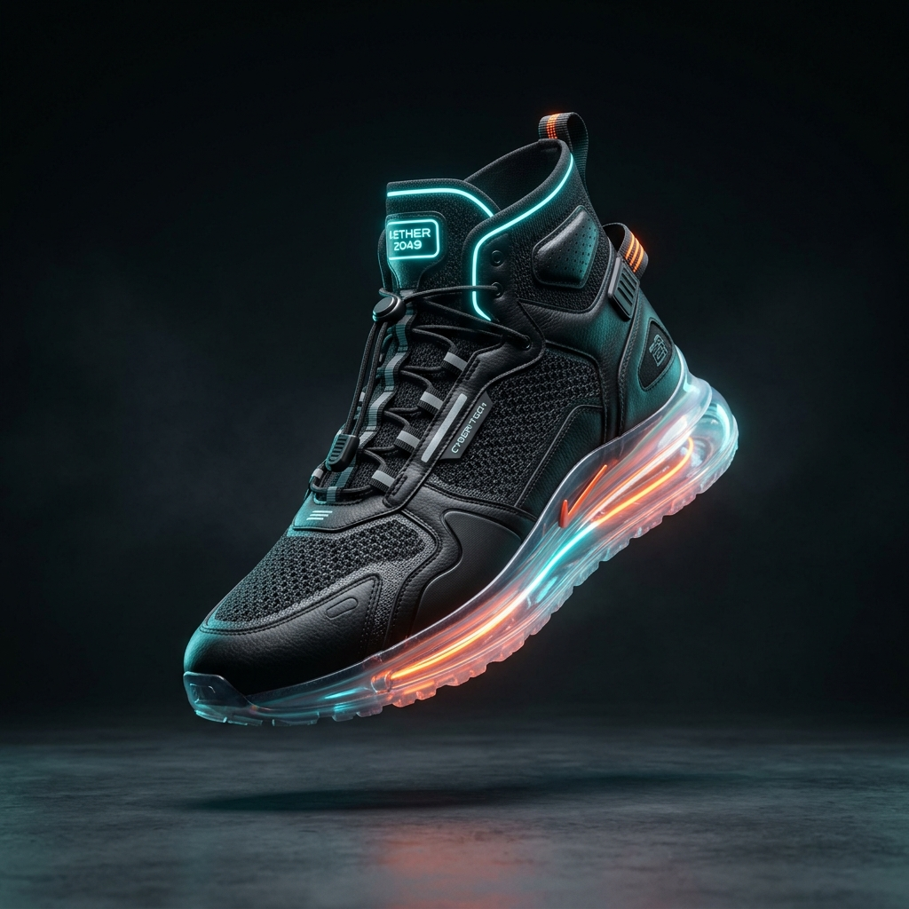

# KICKSLAB™ — Next-Gen Footwear E-Commerce Platform

> **Live Preview & E-Commerce Commercial Web Project**  
> Built for `Balamurugan429/Commercial_Website1`



---

## ⚡ Overview

**KICKSLAB** is an ultra-modern, high-performance commercial website designed specifically for a modern footwear & sneaker studio. It combines sleek streetwear luxury aesthetics with cybernetic accents, responsive micro-interactions, and a full client-side e-commerce engine.

---

## 🚀 Key Features

### 1. 👟 Dynamic Footwear Catalog & Swatches
- **Multi-category filtering**: Streetwear Sneakers, Running/Track, Basketball High-Tops, Leather Boots, Limited Drops.
- **Colorway Switcher**: Interactive swatch dots that dynamically switch product colorways and images.
- **Live Search & Sorter**: Real-time debounce search by shoe name, tech specs, or keywords, plus sorting by price and customer ratings.

### 2. 🛍️ Slide-Out Cart Drawer & Coupon Engine
- Real-time slide-in drawer with item thumbnail, selected size, color, and dynamic quantity adjuster.
- **Free Shipping Progress Tracker**: Visual animated bar tracking progress toward free express shipping ($150 threshold).
- **Promo Code Engine**: Try code `KICKS20` for instant 20% discount.
- Currency Switcher: Instant real-time conversion between **USD ($)** and **INR (₹)**.

### 3. 🔍 Quick View Product Modal
- High-res multi-angle thumbnail gallery.
- Dynamic shoe size selector (US 6 – 13) with interactive size guide.
- Live stock status indicators and technical spec checklists.

### 4. 💳 Express Checkout & Order Simulator
- Multi-step checkout form with customer address input.
- Payment method selection: **Credit Card**, **UPI / GPay**, and **Cash on Delivery**.
- Animated authorization state and instant order confirmation badge with simulated tracking numbers.

### 5. ❤️ Wishlist & Toast Notification System
- One-tap heart wishlist toggle with persistent count badges.
- Smooth floating toast alerts for cart updates, wishlist additions, and coupon alerts.

---

## 📁 Project Architecture

```
Commercial_Website1/
├── index.html              # Core single-page application & semantic layout
├── README.md               # Documentation & setup guide
└── assets/
    ├── css/
    │   └── style.css       # Custom glassmorphism, floating animations & glows
    ├── js/
    │   ├── products.js     # Shoe data matrix (pricing, colorways, specs)
    │   └── app.js          # Cart state, filters, modal handlers, checkout engine
    └── images/
        └── hero-sneaker.png # Custom AI-rendered 8K futuristic flagship sneaker
```

---

## 💻 How to Run Locally

### Option 1: Direct Browser Launch
Simply double-click or open `index.html` in any modern web browser (Chrome, Edge, Firefox, Safari). No installation or build steps required!

### Option 2: Using VS Code Live Server
1. Open the `Commercial_Website1` folder in VS Code.
2. Click **"Go Live"** in the status bar or right-click `index.html` and select **"Open with Live Server"**.

---

## 🌐 Deploy to GitHub Pages

1. Commit and push the code:
   ```bash
   git add .
   git commit -m "feat: complete modern footwear commercial website"
   git push -u origin main
   ```
2. In your GitHub repository (`Balamurugan429/Commercial_Website1`), go to:
   - **Settings** > **Pages**
   - Under **Build and deployment**, select **Deploy from a branch**
   - Choose branch **main** and folder **/(root)**, then click **Save**.
3. Your site will be live at `https://balamurugan429.github.io/Commercial_Website1/`!

---

*Designed & Engineered for Balamurugan S.*
